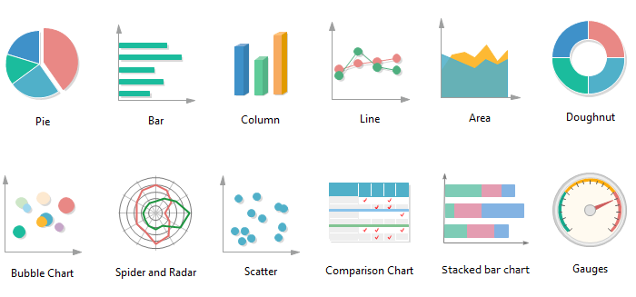
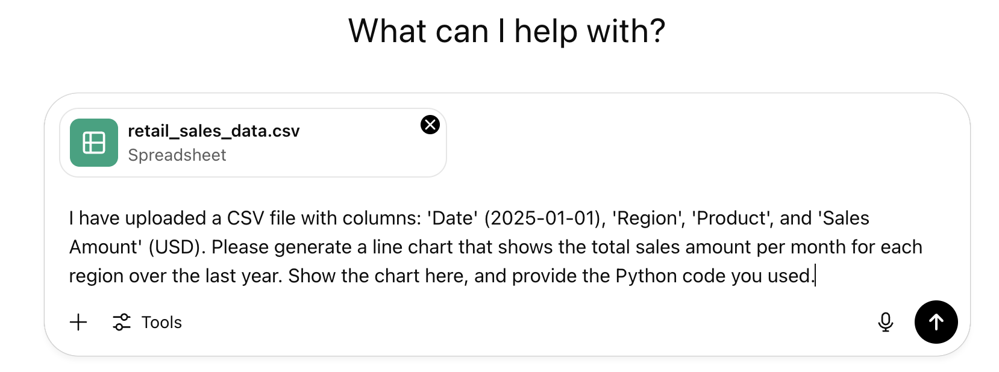

<h1>
  Visualizations and Insight Generation
  Prompting GenAI for Data Visualization
</h1>

> **Learning Objective:**  
> Prompt GenAI to generate useful data visualizations from structured datasets.

---

### Engagement hook

Before we start, think back to a time when you needed to turn numbers or raw data into a chart for a meeting or a report. What made your visualization helpful—or not so helpful—for your audience?  

Type a quick word or phrase in chat, or share out loud.

---

### Connecting business questions to data visualizations

Every impactful data visualization starts with a meaningful business question. Identifying the right question ensures your visualization isn’t just displaying information, but guiding decisions.

Suppose you manage sales data for several regions:

> **Business question:**  
> How have monthly sales trends changed across different regions in the past year?

Notice the key elements: *time* (monthly), *sales* (measure), *regions* (categories).

> 💡 Matching your chart to your question is like using the right tool for a job.

---

### Choosing the right chart type

Here’s a simple guide that matches common business needs to chart types:

- **Trends over time:** line or area charts  
- **Comparing categories:** bar or column charts  
- **Part-to-whole relationships:** pie or stacked bar charts  
- **Analyzing relationships:** scatter plots  
- **Exploring distributions:** histogram or box plots  

If you want to show monthly sales for each region, a multi-line chart works well, with each line representing a region over the same timescale.

---

### Crafting effective prompts for GenAI

To get a visualization you can actually use, make your GenAI prompt clear and structured. Here’s how:

#### 1. Data context

Describe what’s in your dataset.  
*Example:*  
“I have a CSV file with sales records. Columns: Date (YYYY-MM-DD), Region, Product, Sales Amount (USD). Each row is a sale.”

#### 2. Visualization request

Be specific about what you want to see.  
*Example:*  
“Create a line chart showing total monthly sales per region over the last year.”

#### 3. Desired output format

How do you want the results? Options include:

- Chart rendered in the AI interface
- Code (Python, Plotly, etc.)
- Downloadable image (if supported)

*Example:*  
“Please return a rendered plot here and the Python code used to create the visualization.”

**Complete prompt example:**  
“I have uploaded a CSV file with columns: 'Date' (YYYY-MM-DD), 'Region', 'Product', and 'Sales Amount' (USD). Please generate a line chart that shows the total sales amount per month for each region over the last year. Show the chart here, and provide the Python code you used.”

> 🏆 **Best practice:**  
> Not sure about the best chart type? Ask GenAI for a recommendation before generating your chart.

---

### Guided practice: Generating your first visualization with GenAI

Let’s put this into practice. Imagine you work for a retail company and want to understand recent revenue performance.

Suppose your dataset has: Order Date, Country, Customer Segment, Revenue.

Download the dataset: [retail_transactions_sample.csv](assets/retail_transactions_sample.csv)

> **Business question:**  
> Which customer segment generated the highest total revenue last quarter?

**Steps:**  
1. Data context:  
   “I have a CSV file of retail transactions: Order Date, Country, Customer Segment, Revenue (USD).”
2. Chart type:  
   Bar chart (great for comparing categories).
3. Output format:  
   “Display the bar chart here.”

**After running your prompt, review the visualization GenAI generates.**

Consider:
- Does the chart answer your business question?
- Are the filters and labels correct?
- Is the visual easy to interpret?

---

### Iterating your prompts to refine visualizations

Often your first chart won’t be perfect. Refining your prompt is quick and flexible.

Common ways to iterate:

- **Change the chart type:**  
  “Now, show this as a pie chart instead of a bar chart.”
- **Adjust labels or titles:**  
  “Update the chart title to ‘Total Revenue by Customer Segment (Q4),’ and label the y-axis as ‘Total Revenue (USD).’”
- **Add/change filters:**  
  “Only include customer segments with revenue above 10,000 and focus on India.”
- **Request code or export:**  
  “Export this chart as a PNG. Also, provide the Python code used to create it.”

> ♻️ Iterating on prompts is like refining a search or editing a report—each change brings you closer to a visualization that communicates your insights clearly.

> **Chat prompt:**  
> List one change you might make to your initial chart to improve its clarity for stakeholders.

---