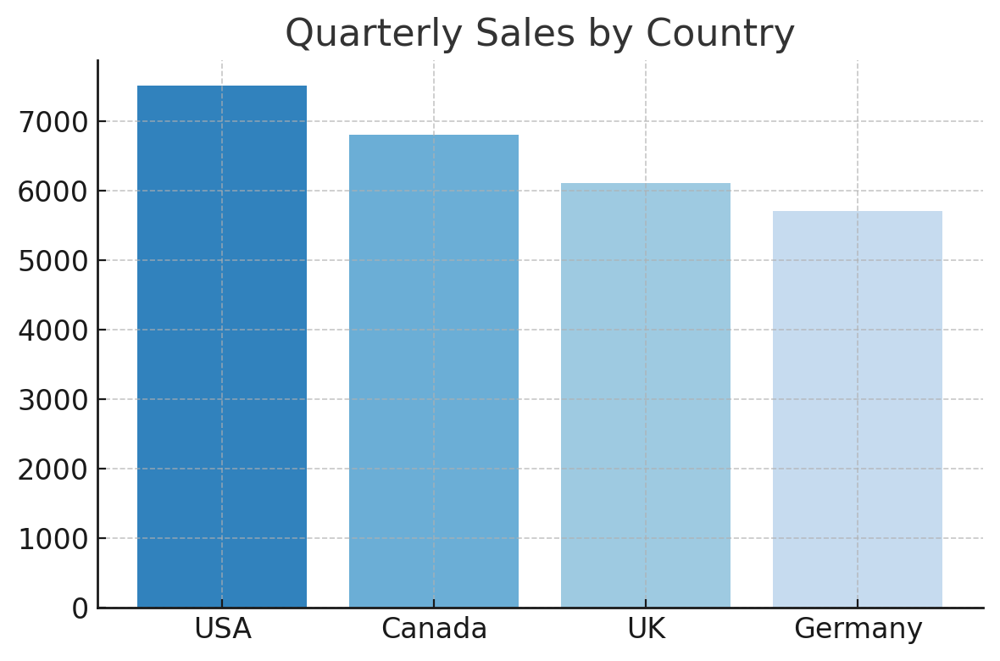
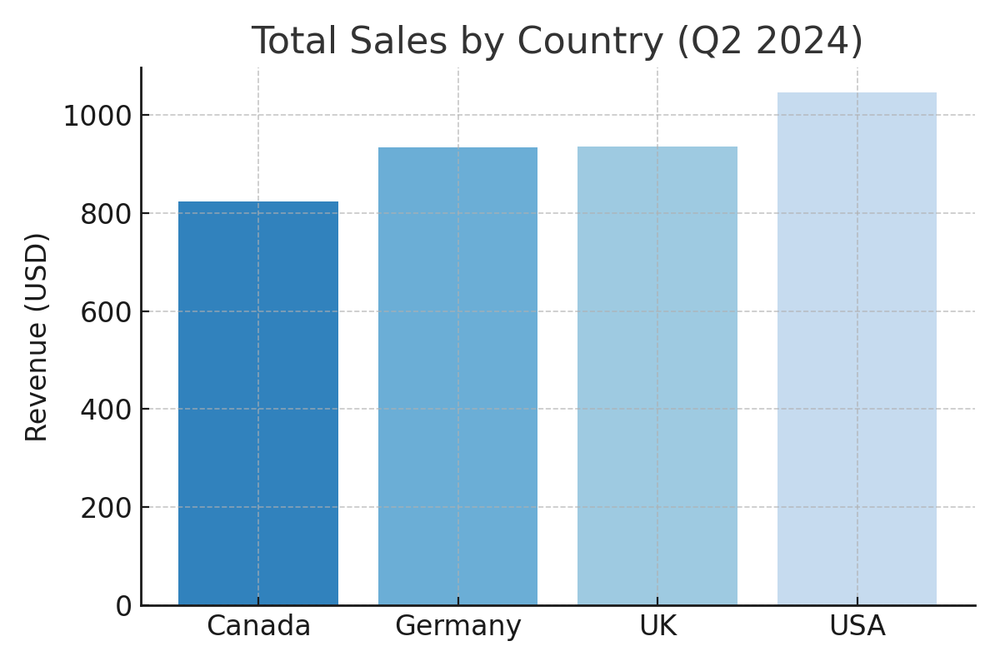
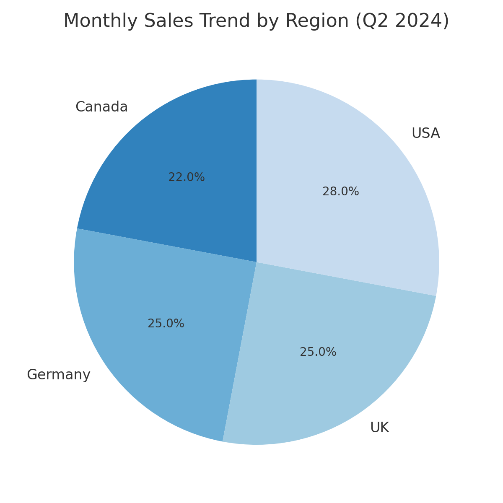
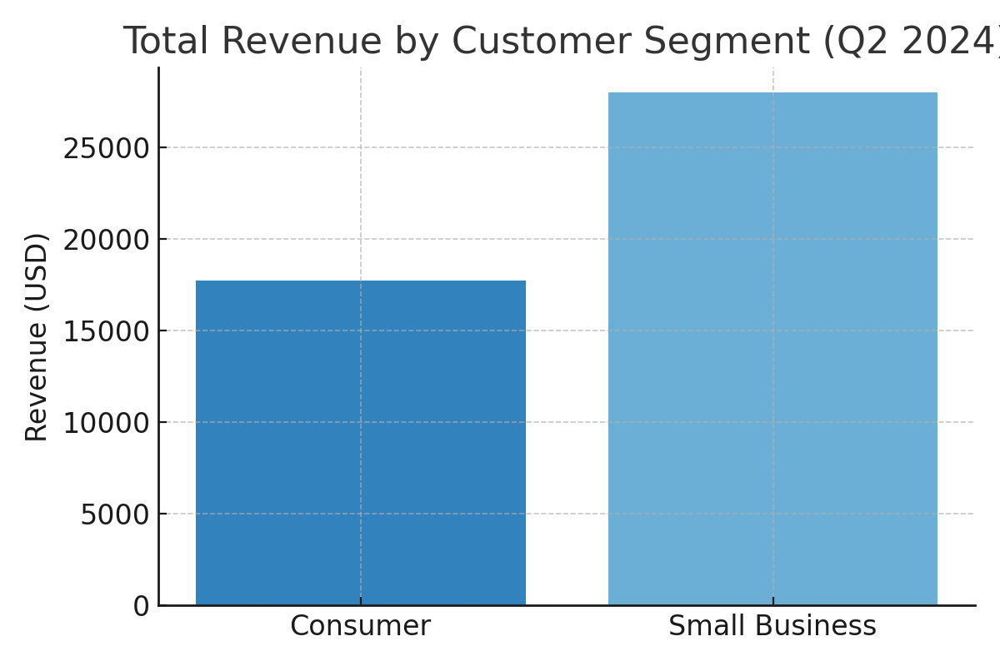
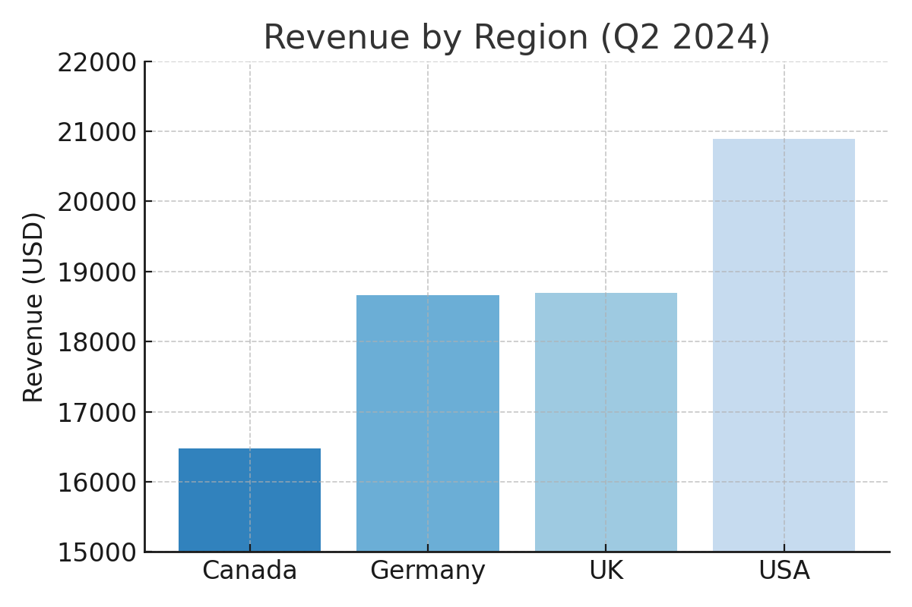
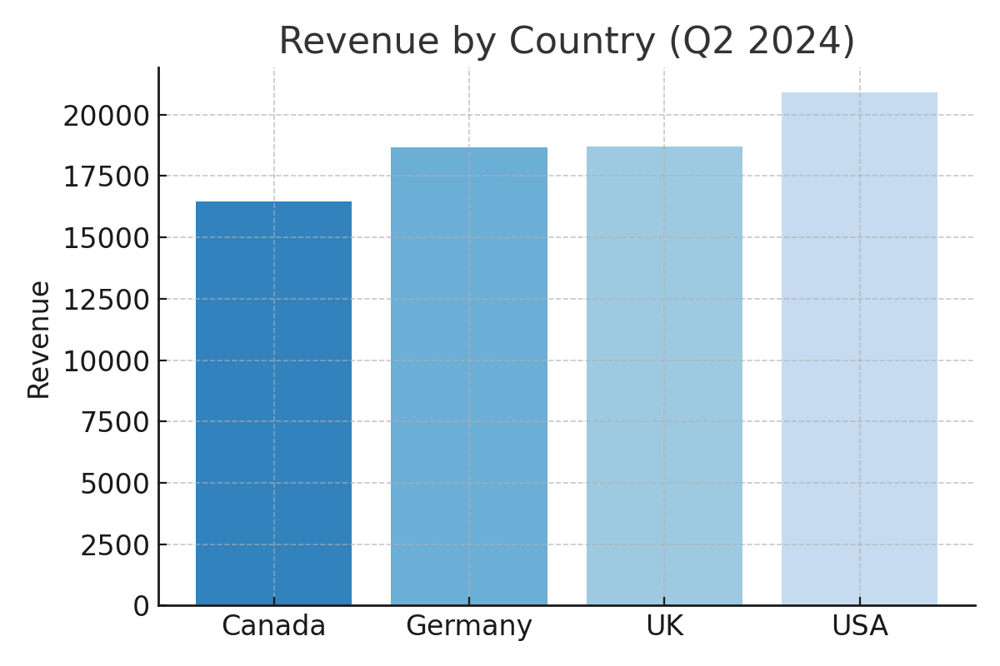

<h1>
  Visualizations and Insight Generation
  Evaluating GenAI-Generated Data Visualizations
</h1>

**Learning Objective:** Evaluate GenAI-generated data visualizations for accuracy, clarity, and relevance—and recognize common pitfalls and errors when using LLMs for data viz.

---

### Would you trust this chart?

You’ve just used GenAI to create this chart for an urgent business meeting. It looks convincing and it was fast!  

But… would you trust it enough to present it to your boss or client? What’s the very first thing you’d check?

---

### Where GenAI-generated charts go wrong

When you use GenAI to spin up a visualization, the results can look right—but there are common ways they can lead you astray. Some of these errors are easy to spot; others are surprisingly subtle.

**Watch out for these typical failure modes:**

| **Failure Mode**              | **What It Looks Like**                                                                             |
|-------------------------------|----------------------------------------------------------------------------------------------------|
| Mismatched or missing labels  | Axes, legends, or units are unclear or missing.                                                    |
| Incorrect filters or groupings| AI aggregates at the wrong level, applies unexpected filters, or omits key segments.               |
| Plausible-but-wrong numbers   | The chart “looks” right, but GenAI made a logic error, hallucinated data, or dropped values.       |
| Misleading chart types or scales | Chart type distorts the story, axes don’t start at zero, or scales jump unexpectedly.            |
| Inconsistent colors or legends| Legend doesn’t match chart, colors repeat, or categories are mislabeled.                           |
| Code bugs and silent failures | GenAI code might have errors or not match your dataset.                                            |

> 🧠 **Why does this happen?**  
> GenAI tools don’t actually “see” your data—they predict what *should* work based on patterns. If your prompt is vague, or your data is unusual, the model may fill in gaps, skip steps, or make plausible (but wrong) guesses.

---

## Activity: Spot the Red Flags in GenAI-Generated Charts

Work in groups to review five GenAI-generated charts, each based on a real business question. Use the evaluation checklist below. For each chart, note any issues or concerns you spot. Be ready to discuss: would you trust this visualization for a business decision?

---

### **Chart Evaluation Checklist**

- Does the chart answer the original business question?
- Are the axes, titles, and labels accurate and clear?
- Are there unexplained gaps, missing segments, or odd results?
- If you add up the values, do they make sense?
- Does anything *look* plausible but feel off?

---

### **1. Chart 1**

**Business question:**  
What were total sales by country last quarter (Q2 2024)?

**Data context:**  
- Columns: Order Date, Country, Customer Segment, Revenue (USD)
- Timeframe: 2024-04-01 to 2024-06-30
- Countries: USA, Canada, UK, Germany

**Sample totals for reference:**
| Country | Total Revenue (USD) |
|---------|---------------------|
| USA     | 21,000              |
| Canada  | 17,000              |
| UK      | 19,000              |
| Germany | 18,500              |

---

### **2. Chart 2**

**Business question:**  
How have monthly sales changed by region?

**Data context:**  
- Data covers April–June 2024 for USA, Canada, UK, Germany

---

### **3. Chart 3**

**Business question:**  
Show total revenue by customer segment.

**Data context:**  
- Customer segments: Consumer, Small Business, Enterprise

**Sample totals for reference:**
| Segment        | Total Revenue (USD) |
|----------------|---------------------|
| Consumer       | 13,500              |
| Small Business | 11,200              |
| Enterprise     | 10,500              |

---

### **4. Chart 4**

**Business question:**  
Compare revenue by region for the last three months.

**Data context:**  
- Countries: USA, Canada, UK, Germany

---

### **5. Chart 5**

**Business question:**  
Which country generated the highest revenue last quarter?

**Data context:**  
- Revenue is in USD.

---

### **Group Discussion**

- What was the most convincing or subtle red flag your group found?
- How can you avoid these mistakes when using GenAI for visualization?
- Which chart, if any, would you trust to present to stakeholders?

> **Pro tip:** Healthy skepticism is your best tool. GenAI is a powerful assistant, but it's not a substitute for your judgment. Trust, but always verify.

